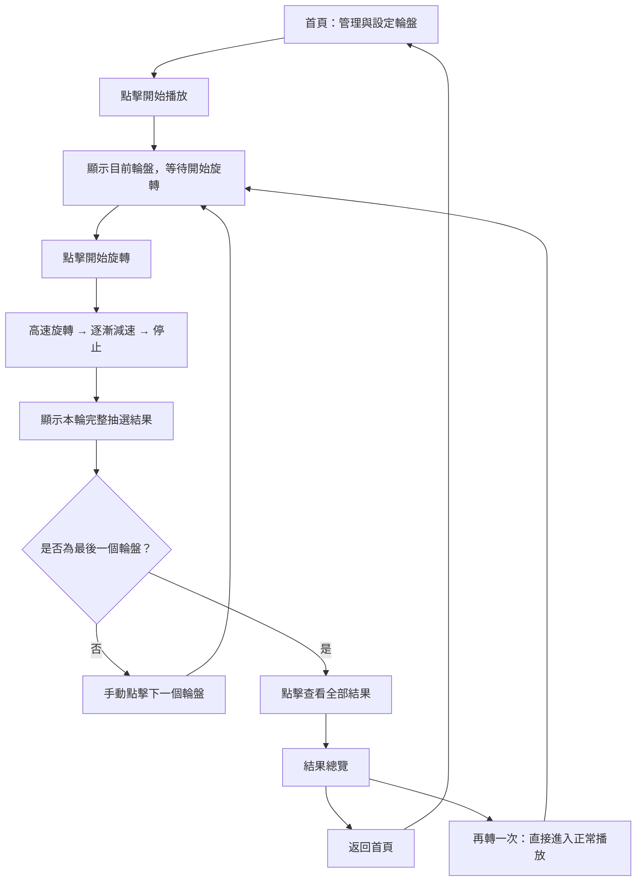
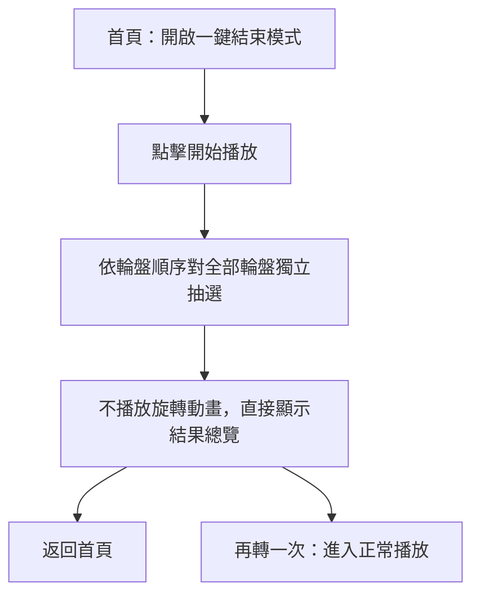

# 多輪盤遊戲 Web App｜網站需求與技術規格書

> **文件版本：V3.7**  
> **文件日期：2026-10-10**  
> **規格狀態：可供開發實作與驗收**  
> **目標交付物：單一 `index.html`**  
> **部署平台：GitHub Pages**

## 0. 文件說明

本規格書由已確認的輪盤遊戲需求彙整而成，供網頁設計、程式實作、測試與驗收使用。無須附帶原始對話或 Master Prompt，即可理解專案的功能與限制。

規範用語：

- **必須／不得**：驗收時應滿足的強制需求。
- **建議**：推薦的設計或實作方式；可以採取等效方案。
- **未指定／由實作者決定**：尚無使用者決策，實作者可在不違反本規格的前提下自行決定，且不得冒稱為已確認需求。

**規格衝突處理：以本文件列出的最新已確認決策為準。** 特別是：抽中空白選項時，結果文字**必須保持完全空白**，不得使用「（空白選項）」等替代標籤。

---

## 1. 專案目標與範圍

### 1.1 專案目標

建立一個不需要後端服務的多輪盤遊戲網頁。使用者可以在首頁建立、編輯、刪除及排序多個輪盤；設定各輪盤的題目、選項與旋轉時間；按照自訂順序進行手動逐輪抽選，或啟用「一鍵結束模式」直接取得全部結果。遊戲結束時以簡潔清單顯示結果，並可返回首頁或重新開始正常播放。

### 1.2 使用情境

1. 使用者開啟網站，在首頁建立多個輪盤。
2. 點選個別輪盤，編輯題目和選項、拖曳調整選項順序。
3. 拖曳調整輪盤播放順序，設定各輪盤的旋轉秒數。
4. 選擇正常播放或透過首頁開關啟用一鍵結束模式。
5. 進入結果總覽；視需要返回首頁調整設定，或「再轉一次」。

### 1.3 非目標與不包含項目

- 不需要使用者登入、帳號權限、雲端同步或後端資料庫。
- 不建立歷史抽選紀錄或查詢頁。
- 首頁輪盤預覽不支援試轉，也不執行隨機抽選。
- 不提供選項權重設定；所有**選項實體**等機率。
- 不要求匯入／匯出檔案、分享到社群、排行榜等功能。
- 不建立正式的輪盤名稱欄位；每個輪盤只有「題目」作為顯示標題。

---

## 2. 技術與部署約束

| 編號 | 要求 | 驗收標準 |
|---|---|---|
| TEC-01 | 專案只有一個部署必要檔案：`index.html` | 只上傳該檔至 GitHub Pages 就能使用 |
| TEC-02 | HTML、CSS、JavaScript 全部位於 `index.html` | 不依賴其他本機檔案 |
| TEC-03 | 不能依賴 CDN 或外部 JS、CSS、字型、圖片、音訊 | 斷開外部資源連線時仍可執行既有功能 |
| TEC-04 | 純前端運作，不使用後端與遠端資料庫 | 在 GitHub Pages 靜態環境正常使用 |
| TEC-05 | 以原生 Web API、HTML5、CSS3、JavaScript 為主 | 不需安裝套件、建置工具或伺服器執行期 |
| TEC-06 | 設定資料透過 `localStorage` 儲存 | 同一網站來源、同一瀏覽器重新開啟後可還原 |
| TEC-07 | 音效以 `Web Audio API` 產生 | 無須外部音訊檔案 |
| TEC-08 | 支援現代 Chrome、Edge、Firefox、Safari | 核心功能在目標瀏覽器通過相容性測試 |
| TEC-09 | 支援桌面、平板、手機的 RWD 與觸控 | 手機上可實際新增、編輯、刪除、排序與播放 |

> `localStorage` 不是雲端備份，不保證在清除網站資料、更換瀏覽器、無痕模式或儲存遭限制時仍存在。系統必須處理寫入失敗，不能顯示虛假的成功狀態。

---

## 3. 畫面與導覽架構

網站為**單頁應用式體驗**，不要求多個 HTML 頁面。至少有下列邏輯畫面與視窗：

| 畫面代號 | 畫面／元件 | 主要用途 |
|---|---|---|
| UI-01 | 首頁：輪盤管理 | 輪盤清單、靜態預覽、新增、刪除、排序、時間設定、模式開關 |
| UI-02 | 輪盤編輯面板 | 修改題目、逐項編輯與排序選項 |
| UI-03 | 正常播放畫面 | 題目、輪盤、開始旋轉、結果、下一輪、返回首頁 |
| UI-04 | 結果總覽 | 依序展示題目與抽中選項、返回首頁、再轉一次 |
| UI-05 | 刪除確認視窗 | 防止誤刪輪盤 |
| UI-06 | 中途返回確認視窗 | 防止誤丟棄尚未結束的本輪結果 |

### 3.1 正常播放流程



### 3.2 一鍵結束流程



---

## 4. 功能需求：首頁與輪盤管理

### 4.1 首頁布局（HOME-001）

- 採用「**輪盤管理清單＋目前選取輪盤的靜態預覽**」混合式布局。
- 清單排列順序即正式輪盤播放順序。
- 首頁應可直接設定每個輪盤的旋轉秒數。
- 桌面版合理並列清單與預覽；手機版可改為上下排列。
- 選取其他輪盤時，預覽應即時切換；編輯資料後，預覽即時更新。
- 預覽**不允許旋轉、試轉或產生抽選結果**。

### 4.2 新增輪盤（HOME-002）

每次新增時建立以下預設內容：

| 欄位 | 預設值 |
|---|---|
| 題目 | `新輪盤` |
| 旋轉秒數 | `5`（秒） |
| 選項數量 | `2` |
| 選項 1 文字 | 空字串 `""` |
| 選項 2 文字 | 空字串 `""` |

- 題目統一使用「新輪盤」，**不自動附加流水號**。
- 允許多個輪盤有完全相同的題目。
- 新輪盤與各選項都需有獨立且穩定的內部 ID。
- 新增後須立即更新清單與持久化資料。

### 4.3 刪除輪盤（HOME-003）

- 點擊刪除時顯示確認視窗，內容應包含即將被刪除的輪盤題目。
- 視窗提供「取消」及「確認刪除」。
- 取消：不變更資料；確認：才刪除該輪盤與旗下選項。
- 刪除行為必須依輪盤 ID 定位，不能依題目文字定位。
- 允許刪除最後一個輪盤。
- 刪除後更新清單、預覽和 `localStorage`。

### 4.4 輪盤排序（HOME-004）

- 可拖曳調整任意輪盤的排列順序。
- 桌面滑鼠與手機觸控都必須能執行。
- 排序後即時反映實際播放順序並自動保存。
- 不得在排序時錯誤交換、刪除或複製輪盤資料。

### 4.5 零輪盤狀態（HOME-005）

- 第一次開啟且尚無輪盤資料時，預設空清單；不自動建立示範輪盤。
- 刪除全部輪盤後，也允許維持空清單。
- 顯示明確空狀態提示及「新增輪盤」操作。
- 零輪盤時，「開始播放」不可執行；即使開啟一鍵結束模式亦同。
- 持久儲存的空陣列 `[]` 是合法資料，不應被當作資料損壞。

---

## 5. 功能需求：輪盤編輯

### 5.1 編輯介面（EDIT-001）

- 點擊輪盤可開啟該輪盤設定。
- **桌面版**採右側編輯面板，盡量保留輪盤清單可見。
- **手機版**採全螢幕編輯面板。
- 提供明確的關閉／返回操作。
- 有效修改應同步更新預覽與儲存資料。

### 5.2 題目（EDIT-002）

- 每個輪盤只有 `title` 題目欄位，不新增 `name` 輪盤名稱欄位。
- 題目不可為空字串、不可只有空白字元；實作應以去除頭尾空白後是否尚有內容判定有效性。
- 允許不同輪盤具有相同題目。
- 首頁、播放畫面及結果總覽顯示相同題目值。
- 編輯時可存在暫時未完成的輸入；**無效值不得作為有效設定持久化，且不能通過播放前驗證**。
- 需清楚提示錯誤，不能默默將無效值當成合法題目。

### 5.3 選項編輯（EDIT-003）

每個選項提供獨立的文字輸入框、刪除按鈕、拖曳把手；另外提供「新增選項」。

- 可自由新增、編輯、刪除及拖曳排序。
- 每個選項具有獨立 ID，排序不改變其身分。
- **空字串有效**，仍可被抽中。
- **重複文字有效**，每個重複項目都是獨立選項。
- 不自動合併重複選項，也不因空白而移除選項。
- 不設定固定選項數量上限，但必須考量瀏覽器能力與可用記憶體。

### 5.4 刪除選項（EDIT-004）

- 選項數量大於 1 時，點擊刪除立即移除該選項，**不彈出確認視窗**。
- 只剩 1 個選項時，點擊刪除只將該選項的 `text` 設為 `""`，**不移除該選項、不更換其 ID**。
- 選項數量必須始終至少為 1。
- 刪除／清空操作立即反映至預覽與 `localStorage`。

### 5.5 時間設定（EDIT-005）

- 每個輪盤獨立設定 `duration`（單位：秒）。
- 合法值為 **1～30 的整數**（含 1、30）；預設為 5。
- 不接受 0、負數、小數、非數字、超過 30 的值。
- 無效值需提示使用者修正，不得保存為有效設定。

---

## 6. 功能需求：抽選規則與旋轉動畫

### 6.1 等機率與獨立性（RAND-001）

- 每個輪盤的抽選彼此完全獨立。
- 每個**選項實體**的抽中機率相同：`P(單一選項) = 1 / N`，`N` 為該輪盤實際選項數。
- 空白及文字重複的選項均計入 `N`，不能合併或忽略。
- 不排除前一次或其他輪盤已抽中的選項。
- 每次重新播放都重新隨機抽選。
- 正常模式和一鍵結束模式**共用同一個抽選函式**。
- 優先以 `crypto.getRandomValues()` 和拒絕取樣等方式取得無取模偏差的隨機索引；若受執行環境限制必須退化，需明確處理，不可宣稱不具備的保證。

**案例：** 5 個選項分別為 `火鍋`、`拉麵`、`""`、`火鍋`、`""`，每個選項實體機率為 20%。文字 `火鍋` 的合計機率為 40%，抽到空字串的合計機率亦為 40%。

### 6.2 扇形與指針（SPIN-001）

- 外觀為現代簡約的**圓形輪盤**，輪盤本體旋轉，指針固定。
- 每個選項均對應獨立扇形，圓心角為 `360° / N`。
- 只有一個選項時，該扇形占完整圓，抽中機率 100%。
- 抽選結果必須在動畫開始時決定；動畫僅負責顯示並停到正確扇形。
- 停止角度必須落於抽中扇形的內部，避免落在扇形邊界。
- 不得在動畫結尾突然跳轉角度修正結果。

### 6.3 旋轉動畫（SPIN-002）

- 使用者手動點擊「開始旋轉」才啟動。
- 動畫在開始時高速旋轉，後段平順減速，最後完全停止。
- 目標動畫時間為該輪盤設定的 1～30 秒。
- 動畫應流暢、避免卡頓；瀏覽器分頁背景化可能造成計時節流，實作應妥善處理。
- 動畫停止後才顯示本輪結果與下一步操作。

### 6.4 旋轉期間的操作限制（SPIN-003）

當狀態為「旋轉中」時：

- 「開始旋轉」必須停用，不能重複觸發。
- 「下一個輪盤」不得使用。
- 網頁內「返回首頁」必須停用。
- 音效／靜音開關仍可使用，且不得改變抽選結果。
- 不得透過其他畫面控制繞過上述限制。

瀏覽器本身的重新整理或關閉分頁不可被完全阻止；重新整理後依第 10 節重置當輪狀態。

### 6.5 輪盤文字呈現（VIS-001）

- 優先在扇形內**完整呈現**選項文字。
- 可依可用空間調整字級、排向、換行與位置。
- 若扇形過小或文字過長而無法清楚閱讀，**直接隱藏該扇形的文字**。
- 不強制省略號、不用數字編號替代。
- 隱藏文字不得刪除扇形或影響抽選。
- 正式顯示抽中結果時，非空白文字必須完整呈現，不應截斷。

### 6.6 配色（VIS-002）

- 視覺風格為現代、簡約、以**柔和淺色系**為主。
- 使用固定的多色循環色盤，各輪盤共用相同配色規則。
- 顏色依選項排列位置分配，不因重新整理或抽選而隨機改變。
- 新增、刪除、排序選項後可依最新順序重新分配顏色。
- 扇形需具有適當分隔與文字對比。具體色碼由實作者決定。

---

## 7. 功能需求：播放、快速模式與結果

### 7.1 正常播放（PLAY-001）

1. 首頁按下「開始播放」，進入第一個輪盤的播放畫面。
2. 題目位於上方、輪盤置中且盡可能放大，操作與結果位於下方。
3. 輪盤初始靜止，等待「開始旋轉」。
4. 點擊後執行公平抽選與旋轉動畫。
5. 停止後顯示本輪結果；使用者須手動點擊「下一個輪盤」。
6. 下一個輪盤同樣初始靜止，不得自動開始旋轉。
7. 最後一個輪盤完成後提供「查看全部結果」，進入結果總覽。

### 7.2 一鍵結束模式（PLAY-002）

- 首頁提供「一鍵結束模式」開關。
- 關閉時：「開始播放」進入正常模式。
- 開啟時：「開始播放」立即依序為所有輪盤抽選，**不播放逐輪動畫**，直接進入結果總覽。
- 不需使用者逐輪點擊開始或下一輪。
- 兩種模式的抽選規則與機率完全一致。
- 一鍵結束模式**不保存至 `localStorage`**；每次重新載入網站時預設關閉。
- 「再轉一次」一律直接進入正常播放，不受前次快速模式影響。

### 7.3 結果總覽（RESULT-001）

- 依輪盤播放順序顯示結果，採**簡潔清單**。
- 每一項只顯示**輪盤題目**與**實際抽中的選項文字**。
- 不顯示機率、旋轉秒數、選項數、統計或多餘資訊。
- 多個輪盤即使同名或抽中相同文字，也分別列出。
- 抽中空字串時，**結果文字保持完全空白**；不得用任何字詞、符號或編號替代。
- 內部必須使用選項 ID／索引及完成旗標辨識結果，不能把空字串誤判為未抽選。
- 結果總覽提供「返回首頁」與「再轉一次」。

### 7.4 再轉一次（RESULT-002）

- 清除上一輪暫存結果。
- 直接重新進入第一個輪盤的**正常播放**畫面。
- 等待使用者手動開始旋轉，後續每輪仍須手動切換。
- 不修改題目、選項、排列順序或旋轉時間。
- 不沿用上一輪結果；允許再次抽中相同選項。

### 7.5 返回首頁（NAV-001）

**正在正常播放、且非旋轉期間：**

- 提供「返回首頁」。
- 點擊後先顯示確認視窗，說明返回會中止本輪並捨棄已抽結果。
- 取消：保留目前畫面與當輪進度。
- 確認：清除當輪結果與進度、回首頁；輪盤設定完整保留。

**旋轉進行中：**

- 禁用網頁內返回首頁操作。

**結果總覽：**

- 可按「返回首頁」，不得因此刪除輪盤設定；歷史抽選結果不保存。

---

## 8. 音效規格

### 8.1 音效行為（AUDIO-001）

- 正常模式旋轉時播放輕微的基本旋轉音效。
- 動畫減速時音效可隨轉速降低節奏或頻率。
- 完全停止時播放短暫結果提示音。
- 提供可明確辨識的靜音／開啟音效控制，旋轉中仍可使用。
- 靜音時不得播放音效，變更音效狀態不得影響抽選與動畫。
- 快速模式不播放旋轉音效。
- 若瀏覽器不支援音效或封鎖音訊播放，遊戲仍須正常運作。

### 8.2 音效狀態保存（AUDIO-002）

- **首次使用預設開啟**。
- 使用者修改後寫入 `localStorage`。
- 重新整理或再次進入網站時，恢復最後一次保存的設定。
- 音訊初始化應遵循瀏覽器的使用者手勢／自動播放限制。

---

## 9. 資料模型與儲存設計

### 9.1 建議資料模型（實作可用等價結構）

```json
{
  "schemaVersion": 1,
  "wheels": [
    {
      "id": "wheel-unique-id",
      "title": "新輪盤",
      "duration": 5,
      "options": [
        { "id": "option-unique-id-1", "text": "" },
        { "id": "option-unique-id-2", "text": "" }
      ]
    }
  ],
  "audioEnabled": true
}
```

> 上述示例是「新增一個輪盤後」的狀態。**首次使用**的 `wheels` 必須是 `[]`。ID 不必採用示例字串，但須足以唯一識別輪盤與選項。選項的順序以及輪盤的順序，應由陣列順序決定。

### 9.2 儲存內容（DATA-001）

| 保存至 `localStorage` | **不**保存至 `localStorage` |
|---|---|
| 輪盤及選項的 ID | 當前播放到哪個輪盤 |
| 輪盤題目 | 目前輪盤動畫狀態 |
| 輪盤與選項排列順序 | 本輪已抽中的結果 |
| 輪盤旋轉秒數 | 歷史抽選結果 |
| 各選項原始文字 | 一鍵結束模式開關狀態 |
| 音效開關狀態 | 當輪執行狀態 |

- 新增、刪除、有效編輯、拖曳排序後自動儲存。
- 不應將使用者輸入內容當作 HTML 注入到 DOM；採安全的文字節點／`textContent` 等方式渲染。
- 空白選項需保留為空字串，不得在序列化時自動刪除。
- 合法空清單 `[]` 必須保留。

### 9.3 異常處理（DATA-002）

- 必須處理儲存遭拒、容量不足及 `localStorage` 不可用。
- 必須檢查 JSON 解析錯誤與資料結構異常。
- 無法保存時應清楚提示使用者，不能默默宣稱成功。
- 不得在無明確判斷的情況下用空資料直接覆蓋原有可恢復設定。
- 必須能處理含有 Unicode、特殊符號、換行、重複及空白文字的選項。
- 輪盤數量或選項數量極多時，可提醒效能限制，不得任意剔除可抽選項目。

---

## 10. 重新整理與狀態管理

### 10.1 重新整理（STATE-001）

無論使用者目前處於等待開始、旋轉中、已抽選部分輪盤或結果總覽，重新整理網站後都要：

1. 返回首頁。
2. 從 `localStorage` 讀回全部合法輪盤設定與音效設定。
3. 清除當輪播放進度、結果及動畫狀態。
4. 將一鍵結束模式設為關閉。
5. 不額外實作重新整理前的 `beforeunload` 警告。

### 10.2 建議畫面狀態機

| 狀態 | 可執行的關鍵操作 | 不可執行的操作 |
|---|---|---|
| `home` | 管理輪盤、切換快速模式、開始播放 | 零輪盤時開始播放 |
| `ready` | 開始旋轉、確認後返回首頁 | 下一輪（尚未抽選） |
| `spinning` | 切換靜音 | 重複旋轉、返回首頁、下一輪 |
| `settled` | 下一個輪盤／查看結果、確認後返回首頁 | 再次旋轉同一輪盤 |
| `results` | 返回首頁、再轉一次 | 將本輪結果加入歷史紀錄 |

> 此狀態表是便於實作的工程建議；若採不同內部命名，也必須保有相同行為。

---

## 11. UI／UX 與響應式需求

### 11.1 共同設計原則

- 整體視覺風格現代簡約，輪盤扇形以柔和淺色系為主。
- 選擇清楚的字級、留白、對比與操作狀態。
- 操作按鈕須有清楚的啟用、停用及反饋。
- 題目與結果區域須支援長文字、換行，不可不合理裁切。
- 結果頁避免不必要的統計資訊，保持閱讀聚焦。

### 11.2 桌面版

- 首頁清單與靜態預覽可並列。
- 編輯輪盤時開啟右側面板。
- 正常播放採置中聚焦布局，盡可能放大輪盤但保持圓形。

### 11.3 手機與平板

- 完整支援新增、編輯、刪除、拖曳輪盤、拖曳選項、時間設定、模式切換、音效控制及播放。
- 手機版編輯介面使用全螢幕面板。
- 輪盤應依可用寬高縮放，不可變成橢圓形。
- 主要功能不應發生橫向溢出或被固定按鈕遮擋。
- 觸控拖曳時須妥善區分捲動與排序；不能只支援滑鼠拖曳。
- 建議提供適當大小的觸控目標與明確的拖曳把手。

### 11.4 無障礙與可操作性

- 互動控制應使用語意適當的按鈕、輸入欄位與清楚的標籤。
- 確認視窗應具合理的焦點管理與鍵盤操作。
- 停用按鈕應具有視覺與程式狀態上的一致性。
- 如實作動畫減量偏好支援，不得變更抽選結果或跳過使用者明確要求的必要操作流程。

---

## 12. 驗收測試案例

以下案例需以實際網站行為驗證。若沒有執行測試，不得宣稱已通過。

### 12.1 首頁及管理

| 測試編號 | 測試步驟 | 預期結果 |
|---|---|---|
| T-01 | 第一次開啟無資料的網站 | 清單為空、顯示新增引導、播放不能啟動 |
| T-02 | 新增輪盤 | 題目「新輪盤」、5 秒、兩個空白選項 |
| T-03 | 新增兩個同名輪盤後刪除其中一個 | 只刪除指定 ID 的輪盤 |
| T-04 | 點擊刪除後選取消 | 輪盤資料不變 |
| T-05 | 點擊刪除後選確認 | 指定輪盤被刪除並持久化 |
| T-06 | 刪除最後一個輪盤再重新整理 | 仍為空清單，不自動建立輪盤 |
| T-07 | 滑鼠與手機觸控拖曳輪盤 | 順序更新並保持至重新整理後 |
| T-08 | 修改某輪盤旋轉時間為 1、30、0、31、1.5 | 前兩者有效；後三者不接受為合法值 |

### 12.2 選項與題目

| 測試編號 | 測試步驟 | 預期結果 |
|---|---|---|
| T-09 | 將題目改成空字串或全空格 | 顯示無效提示，不得作為有效設定播放 |
| T-10 | 建立空白與重複文字選項 | 均保留且均可抽選 |
| T-11 | 將選項刪到只剩一個，再點刪除 | 只清空文字，選項 ID 與數量保留 |
| T-12 | 拖曳交換相同文字的兩個選項 | ID 與資料身分仍正確 |
| T-13 | 建立很長的選項文字 | 空間足夠才在扇形完整顯示；不足時隱藏輪盤內文字 |
| T-14 | 在手機觸控拖曳選項 | 排序成功且不誤刪內容 |

### 12.3 抽選、動畫與快速模式

| 測試編號 | 測試步驟 | 預期結果 |
|---|---|---|
| T-15 | 僅保留一個空白選項並開始旋轉 | 可正常旋轉並選中該唯一選項 |
| T-16 | 設定兩個同文選項與一個其他選項，多次抽樣 | 三個選項實體各有相等機率，無去重；統計僅用於合理性檢查 |
| T-17 | 進入正常播放畫面 | 輪盤初始靜止，等待手動啟動 |
| T-18 | 輪盤旋轉期間反覆點擊開始、下一輪、返回 | 不重複抽選、不跳輪、不離開 |
| T-19 | 旋轉結束 | 指針指向抽中扇形內部，顯示對應結果 |
| T-20 | 完成非最後一輪 | 必須手動點下一個輪盤，不能自動跳轉 |
| T-21 | 首頁開啟一鍵結束並按開始播放 | 直接產生所有輪盤結果，沒有逐輪旋轉動畫 |
| T-22 | 使用一鍵結束後按再轉一次 | 進入第一輪正常播放，等待手動旋轉 |
| T-23 | 抽中空字串選項 | 結果文字完全空白，內部仍標記為已抽選 |

### 12.4 音效、狀態與儲存

| 測試編號 | 測試步驟 | 預期結果 |
|---|---|---|
| T-24 | 首次使用網站 | 音效設定預設開啟（實際發聲仍受瀏覽器政策限制） |
| T-25 | 設為靜音後重新整理 | 保持靜音 |
| T-26 | 開啟一鍵結束後重新整理 | 一鍵結束模式恢復關閉 |
| T-27 | 正常播放中點返回首頁並取消 | 留在原播放狀態，結果不變 |
| T-28 | 正常播放中點返回首頁並確認 | 回首頁，當輪進度清除，設定保留 |
| T-29 | 旋轉中直接重新整理 | 回首頁，設定保留、不恢復當輪抽選 |
| T-30 | 結果頁按再轉一次 | 舊結果不再沿用，重新正常播放 |
| T-31 | 模擬儲存空間不足或儲存遭拒 | 清楚提示失敗，網站不應假裝已成功保存 |
| T-32 | 模擬損壞的儲存 JSON | 顯示適當錯誤處理，不應無提示直接破壞資料 |
| T-33 | 網站只放單一 `index.html` 部署 GitHub Pages | 所有主要功能可操作，無必要的外部資源請求 |

> 隨機抽選的統計測試可以評估分布是否合理，但有限次測試無法數學上證明「完全公平」。應同時檢查抽樣演算法與不同選項的映射方式。

---

## 13. 實作參考與尚未指定的細節

以下項目不影響本規格可實作性，留給實作者作出合理、前後一致的決定：

- 使用 Canvas、SVG 或其他原生方法繪製輪盤。
- 扇形淺色循環的具體 HEX 色碼與顏色數量。
- 字型、間距、陰影、RWD 斷點與編輯面板精確寬度。
- 指針造型、旋轉方向、旋轉圈數及緩動曲線。
- 音效開關放置位置、Web Audio 波形與音量細節。
- 結果頁返回首頁後，快速模式開關在**同一個未重新載入的頁面工作階段**是否保留；但重新載入必須關閉，且「再轉一次」必須直接採正常播放。
- 一鍵結束模式是否播放簡短的完成提示音；**不得播放旋轉音效**。
- 原始選項文字若只有空白字元，必須維持原始資料、不自動改為其他字詞；畫面不應補入「空白選項」標籤。

對於未指定事項，優先考量：**既有需求一致性 → 功能正確 → 資料安全 → 觸控易用性 → 效能 → 美觀**。不得擅自新增會改變抽選規則或操作流程的功能。

---

## 14. 交付標準

**必要交付：** 可直接使用與部署的單一 `index.html`，包含完整 HTML、CSS、JavaScript 和所有核心互動。

開發完成時應至少做到：

1. 所有需求中的按鈕、欄位、拖曳與畫面切換是真實功能，不是靜態展示或偽造互動。
2. 所有輪盤抽選使用實際隨機邏輯，不使用寫死的示範結果。
3. 程式內合理分離資料操作、狀態控制、隨機抽選、輪盤繪製、動畫與音效。
4. 可在 GitHub Pages 的靜態託管條件下執行。
5. 依第 12 節測試案例逐項驗收，未執行的測試應誠實標示未驗證。
6. 若受工具或執行環境限制無法達成部分需求，應明確列出未完成項目，不得宣稱已全部完成。

**最終完成定義：網站不只具有現代簡約的外觀，而是能在桌面與手機上完成輪盤設定、正確抽選、逐輪播放／一鍵結束、簡潔結果呈現，以及重載後正確保留設定的完整產品。**
